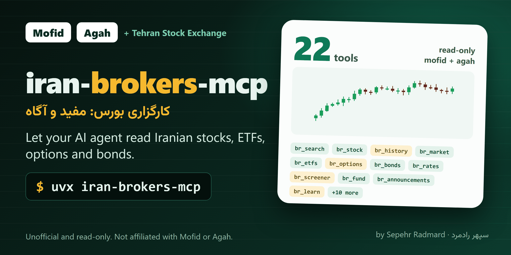

<!-- mcp-name: io.github.sepehr071/iran-brokers-mcp -->

<div align="center">



# iran-brokers-mcp: Iranian broker (کارگزاری بورس) market data MCP server for AI agents

**iran-brokers-mcp is an unofficial, read-only MCP server that lets an AI agent read Tehran Stock Exchange market data through two Iranian brokers, Mofid Securities (کارگزاری مفید, emofid.com) and Agah (کارگزاری آگاه, agah.com).**<br>
Its 22 tools cover stocks, ETFs and funds (صندوق سرمایه‌گذاری), options (آپشن), bonds and sukuk (اوراق), gold coins (سکه) and currency, screeners, Codal announcements and education articles, on Tehran Stock Exchange (بورس تهران) and Fara Bourse (فرابورس).<br>
No API key or broker account is needed, and it works in Claude, Cursor, Copilot and any other MCP client.

[](https://pypi.org/project/iran-brokers-mcp/)
[](https://pypi.org/project/iran-brokers-mcp/)
[](https://github.com/sepehr071/iran-brokers-mcp/actions/workflows/ci.yml)
[](https://registry.modelcontextprotocol.io/?q=iran-brokers-mcp)
[](https://github.com/sepehr071/iran-brokers-mcp/blob/main/LICENSE)

[](https://vscode.dev/redirect/mcp/install?name=iran-brokers&config=%7B%22command%22%3A%22uvx%22%2C%22args%22%3A%5B%22iran-brokers-mcp%22%5D%7D)
[](https://cursor.com/install-mcp?name=iran-brokers&config=eyJjb21tYW5kIjoidXZ4IiwiYXJncyI6WyJpcmFuLWJyb2tlcnMtbWNwIl19)

[For AI agents](#for-ai-agents) · [What it can do](#what-it-can-do) · [Quick start](#quick-start) · [Tools](#tools) · [Limits](#limits) · [FAQ](#faq) · [فارسی](#فارسی)

</div>

---

Last verified 2026-11-01 against the live Mofid and Agah APIs.

## For AI agents

- **What:** unofficial MCP server (model context protocol) for Mofid and Agah: symbol search, stock cards, OHLC candles and daily history, market snapshot, 36 Mofid rankings, Agah market watch and screener, ETFs with price vs NAV, fund detail/history/comparison, options chain and contract, bonds and T-bills, currency/coin/gold/commodity prices and history, Codal filings, valuation scores, technical tally, education articles and courses.
- **Install:** `uvx iran-brokers-mcp` or `claude mcp add iran-brokers -- uvx iran-brokers-mcp`. Transport: stdio. Needs [uv](https://docs.astral.sh/uv/getting-started/installation/) (Python 3.10+).
- **Auth:** none. Optional `IRAN_BROKERS_MCP_PROXY` (one HTTP proxy URL for every request, or a comma-separated list); system proxy settings are ignored.
- **Access:** read-only market data. It cannot log in, read a portfolio, cash or orders, place, edit or cancel orders, or pay. No confirmation is needed before calling any tool.
- **Tools:** 22, all prefixed `br_`. Typical sequences: `br_search` -> `br_stock` / `br_history`; `br_market` -> `br_market_top` or `br_stocks`; `br_etfs` -> `br_stock` or `br_fund`; `br_screener`; `br_rates`; `br_announcements`; `br_learn` -> `br_learn(ref=...)`.
- **`source` argument:** each source answers in its own block (`{"mofid": ..., "agah": ...}`). With `all`, a source that fails shows `{"error": ...}` and the other still answers. Blocks are never blended into one row, because the fields differ.
- **Use when:** the user asks for a stock, fund, option, index, gold or dollar price on the Iranian market, a ranking or screen, a chart, a company's Codal filings, or how something in the bourse works.
- **Do not use when:** the user wants to trade, see their own portfolio, or needs real-time tick data (everything here is a polled snapshot). For raw exchange data use [tsetmc-mcp](https://github.com/sepehr071/tsetmc-mcp); for full financial statements use [codal-mcp](https://github.com/sepehr071/codal-mcp).
- **Output:** compact JSON. Prices are Rial (divide by 10 for Toman). Text Persian.
- **Machine-readable:** [`server.json`](https://github.com/sepehr071/iran-brokers-mcp/blob/main/server.json) and the [iran-mcp catalog](https://github.com/sepehr071/iran-mcp).

## What it can do

- **Get Tehran Stock Exchange data in Claude:** find a symbol, read its price card (P/E, EPS, NAV, buyer and seller flows, order book), candles from 1 minute to weekly, and the market snapshot with indices and movers
- **Compare Iranian ETFs from an AI agent:** list ETFs with price, NAV and the bubble gap (Mofid 375 ETFs, Agah 331 listed ETFs), then read one fund's detail, NAV history or compare several
- **Read the options chain** (call and put contracts) and one contract's detail
- **Screen stocks, ETFs or funds** on any column with the Agah screener, or use Mofid's 36 rankings (top gainers, value, queues and more)
- **Bonds, sukuk and T-bills** with yield, plus currency, crypto, coin (سکه), gold and commodity prices with history
- **Codal announcements** by company, type and date, plus notices, news and research PDFs
- **Valuation and technical scores**: theoretical price, fundamental and technical scores, indicator tally per stock or industry
- **Education:** Mofid blog, Agah Pedia articles and Agah Academy courses
- **Read-only by design**: no login, no orders, no captcha solving

Example prompts:

- "Get today's Tehran Stock Exchange summary: indices, top movers and the dollar and coin prices."
- "Compare Iranian ETFs by price versus NAV and show which trade at the biggest premium."
- "Show the options chain for Foolad and the details of one call contract."
- "Which stocks have the lowest P/E and a positive money flow this week?"
- <span dir="rtl">قیمت و نسبت قیمت به NAV صندوق‌های طلا را مقایسه کن.</span>
- <span dir="rtl">بیشترین صف خرید امروز بورس کدام نمادهاست؟</span>
- <span dir="rtl">آخرین اطلاعیه‌های کدال نماد فولاد را بیاور.</span>

## Quick start

You need [uv](https://docs.astral.sh/uv/getting-started/installation/). No API key or account.

<details open>
<summary><b>Claude Code</b></summary>

```bash
claude mcp add iran-brokers -- uvx iran-brokers-mcp
```
</details>

<details>
<summary><b>Claude Desktop</b></summary>

Settings → Developer → Edit Config, then add:

```json
{
  "mcpServers": {
    "iran-brokers": { "command": "uvx", "args": ["iran-brokers-mcp"] }
  }
}
```
</details>

<details>
<summary><b>Cursor</b></summary>

Click **Install in Cursor** above, or add the Claude Desktop block to `~/.cursor/mcp.json` (or `.cursor/mcp.json` in a project).
</details>

<details>
<summary><b>VS Code (Copilot agent mode)</b></summary>

Click **Install in VS Code** above, or add to `.vscode/mcp.json`:

```json
{
  "servers": {
    "iran-brokers": { "type": "stdio", "command": "uvx", "args": ["iran-brokers-mcp"] }
  }
}
```
</details>

<details>
<summary><b>Anything else</b></summary>

It is a standard stdio MCP server: run `uvx iran-brokers-mcp`, or `pip install iran-brokers-mcp` and run `iran-brokers-mcp`.
</details>

## Tools

Merged tools take `source`: `mofid`, `agah` or `all` (the default is in brackets). Single-source tools say which broker they use.

| Tool | Source | What it does |
|---|---|---|
| `br_search` | both [all] | Find the id of a stock, fund, option or index by symbol or name |
| `br_stock` | both [all] | One stock or ETF in detail: Mofid price card (P/E, EPS, NAV, flows, scores, optional 5-level order book) and Agah card (ratios, returns, flows, order book) |
| `br_history` | both [mofid] | Mofid OHLC candles (1 minute to weekly, any ISIN) or Agah daily rows with buyer/seller flows |
| `br_market` | both [all] | Today's indices, value, queues (Mofid) and total index, money flow, movers, dollar/coin/gold/oil prices (Agah) |
| `br_industries` | both [all] | Industry ranking with valuation ratios, returns and money flow; one industry with its stocks |
| `br_index` | both [all] | Index card (Mofid) and daily index history (both) |
| `br_etfs` | both [mofid] | ETFs with price, NAV and gap/bubble: Mofid 375 ETFs, Agah 331 listed ETFs with NAV returns |
| `br_learn` | both [all] | Search and read Mofid blog and Agah Pedia articles, list categories, search Agah Academy courses |
| `br_quotes` | Mofid | Up to 30 live quotes in one call |
| `br_market_top` | Mofid | 36 market rankings |
| `br_bonds` | Mofid | Bonds, sukuk and T-bills with yield |
| `br_rates` | Mofid | Currency, crypto, coin, gold and commodity prices and their history |
| `br_news` | Mofid | Notices, Codal letters, Telegram posts and research PDFs |
| `br_announcements` | Mofid | Codal filings by company, type and date |
| `br_scores` | Mofid | Theoretical price, technical and fundamental scores |
| `br_mofid_funds` | Mofid | Mofid-branded fund catalogue |
| `br_stocks` | Agah | Market watch of about 750 stocks |
| `br_screener` | Agah | Filter stocks, ETFs or all funds on any column |
| `br_fund` | Agah | Fund detail, NAV and bubble history, comparison of funds |
| `br_options` | Agah | Options chain, or one contract |
| `br_technical` | Agah | Technical indicator tally for a stock or industry |
| `br_stock_events` | Agah | Dividends, capital changes, notices and holders |

Every tool is read-only. If you used the separate mofid-mcp or agah-mcp servers: `mf_search` and `ag_search` -> `br_search`; `mf_symbol`, `mf_depth`, `ag_stock` -> `br_stock`; `mf_history`, `ag_stock_history` -> `br_history`; `mf_market_summary`, `ag_market_pulse`, `ag_market_overview` -> `br_market`; `mf_industries`, `ag_industries` -> `br_industries`; `mf_index`, `ag_index_history` -> `br_index`; `mf_etfs` -> `br_etfs`; `mf_learn`, `mf_learn_categories`, `ag_articles`, `ag_article`, `ag_academy` -> `br_learn`; `mf_fx_gold`, `mf_rate_history` -> `br_rates`; `ag_fund`, `ag_fund_trend`, `ag_fund_compare` -> `br_fund`; `ag_options`, `ag_option` -> `br_options`; the others keep their name with the `br_` prefix (`mf_quote` -> `br_quotes`).

## Limits

- **No portfolio, orders or cash.** Those need a broker login (EasyTrader, AsaTrader); nothing here logs in or can place an order, and this is not built.
- **Agah Pedia and Academy answer only from an Iranian network** (`pediaapi.agah.com`, `academyapi.agah.com` time out from abroad). The error says so; the Mofid side of `br_learn` still answers. Do not put a foreign proxy in front of them.
- **Mofid depends on the `accept-info` header** of the Bourse View gateway (derived from the server clock; the client resyncs on a 401). If the site changes that check, Mofid tools fail with an HTTP 401 error and the Agah side keeps working.
- **Data is polled snapshots**, cached 30 to 60 seconds, delayed or unaudited; the market trades Saturday to Wednesday about 09:00-12:30 Tehran time.
- The two sources use different ids for funds (Mofid ISIN, Agah 11-digit national code) and different fields, so merged tools show them side by side.
- **Prices are Rial**; divide by 10 for Toman. Dates follow each site.

## FAQ

<details>
<summary><b>How do I get Tehran Stock Exchange data in Claude?</b></summary>

Add `iran-brokers-mcp` with `claude mcp add iran-brokers -- uvx iran-brokers-mcp`, then ask in plain language. The agent finds the symbol with `br_search`, reads it with `br_stock` or `br_history`, and gets the market overview from `br_market`.
</details>

<details>
<summary><b>How can I compare Iranian ETFs and funds with an AI agent?</b></summary>

Use `br_etfs` for the list with price, NAV and gap (bubble), `br_fund` for one fund's detail, NAV history or a side-by-side comparison, and `br_screener` to filter funds on any column.
</details>

<details>
<summary><b>Is there an API for Mofid or Agah market data?</b></summary>

Neither broker documents a public API. This server calls the same public JSON the websites use, without login, and returns compact JSON.
</details>

<details>
<summary><b>Can it place orders or show my portfolio?</b></summary>

No. It is read-only and has no login. Portfolio, cash and orders need your broker account and are not built.
</details>

<details>
<summary><b>Does it work outside Iran?</b></summary>

Yes for Mofid and Agah Research. Agah Pedia and Academy answer only from an Iranian network. Set `IRAN_BROKERS_MCP_PROXY` to route through a proxy; do not use a foreign one for Pedia and Academy.
</details>

<details>
<summary><b>Is it allowed?</b></summary>

It calls the public endpoints the websites use, two requests at a time per broker and with caching, and each client sends the headers its site's web app sends (Chrome TLS fingerprint, Referer, Accept, Mofid's `accept-info`).
</details>

<details>
<summary><b>How is it different from tsetmc-mcp and codal-mcp?</b></summary>

[tsetmc-mcp](https://github.com/sepehr071/tsetmc-mcp) and [codal-mcp](https://github.com/sepehr071/codal-mcp) read the exchange and Codal directly; this server reads the brokers' own views of the same market (rankings, screeners, NAV gaps, options, education).
</details>

<details>
<summary><b>Is the data real time? Is it investment advice?</b></summary>

No to both. Data is polled snapshots cached for 30 to 60 seconds. Nothing it returns is financial advice.
</details>

## Configuration

| Variable | Default | Meaning |
|---|---|---|
| `IRAN_BROKERS_MCP_PROXY` | unset | Optional HTTP proxy URL for all Mofid and Agah requests; system proxy settings are ignored. A comma-separated list is used one at a time: the next proxy takes over when one is blocked or cannot connect |

<a id="فارسی"></a>

## فارسی: سرور MCP کارگزاری‌های مفید و آگاه برای دستیار هوش مصنوعی

<div dir="rtl">

پروژه **iran-brokers-mcp** یک سرور MCP غیررسمی و فقط‌خواندنی است که داده‌های عمومی بازار سرمایه را از دو کارگزاری، **کارگزاری مفید** (emofid.com) و **کارگزاری آگاه** (agah.com)، در اختیار دستیار هوش مصنوعی (Claude، Cursor، Copilot و ...) می‌گذارد.

**چه کارهایی می‌کند**

- **سهام بورس تهران و فرابورس:** جستجوی نماد، کارت قیمت، کندل، تاریخچه روزانه، خلاصه بازار و شاخص‌ها.
- **صندوق‌های سرمایه‌گذاری و ETF:** قیمت، NAV، حباب، تاریخچه و مقایسه صندوق‌ها.
- **اوراق و آپشن:** اوراق بدهی، صکوک، اوراق خزانه با بازده؛ زنجیره آپشن و جزئیات هر قرارداد.
- **سکه، طلا و ارز:** قیمت و تاریخچه.
- **غربالگر و رتبه‌بندی:** ۳۶ رتبه‌بندی مفید و غربالگر آگاه روی هر ستون.
- **اطلاعیه‌های کدال، خبر و آموزش:** مقاله‌ها و دوره‌های مفید و آگاه.

**نکته‌ها**

- فقط‌خواندنی است: ورود به حساب، سبد دارایی، موجودی و ثبت سفارش ندارد.
- پدیا و آکادمی آگاه فقط از اینترنت ایران جواب می‌دهد.
- داده‌ها لحظه‌ای نیست و هر ۳۰ تا ۶۰ ثانیه تازه می‌شود. مبلغ‌ها ریال است. توصیه سرمایه‌گذاری نیست.
- کلید API لازم نیست و سرور روی سیستم خود شما اجرا می‌شود.

**نصب** (اول [uv](https://docs.astral.sh/uv/getting-started/installation/) را نصب کنید). در Claude Code:

</div>

```bash
claude mcp add iran-brokers -- uvx iran-brokers-mcp
```

## Development

```bash
git clone https://github.com/sepehr071/iran-brokers-mcp && cd iran-brokers-mcp
uv sync
uv run ruff check . && uv run ruff format --check .
uv run python -m pytest -q          # offline unit tests on recorded responses
uv run python -m pytest -m live -q  # live pass against Mofid and Agah
uv build
```

Releases: bump the version in `pyproject.toml` and `server.json`, then push a `v*` tag. GitHub Actions publishes to PyPI. Issues and PRs are welcome.

## Related servers

- [tsetmc-mcp](https://github.com/sepehr071/tsetmc-mcp) for Tehran Stock Exchange prices, order book, real vs legal trading and indices
- [codal-mcp](https://github.com/sepehr071/codal-mcp) for Codal disclosures and financial statements
- [iran-gold-mcp](https://github.com/sepehr071/iran-gold-mcp) for live 18k gold prices on Iranian platforms
- [iran-mcp](https://github.com/sepehr071/iran-mcp): catalog of all Iranian-service MCP servers

## Disclaimer

Unofficial and not affiliated with or endorsed by Mofid Securities or Agah. It is read-only and uses the public endpoints of their websites, which can change without notice. Data is informational, delayed and unaudited. Nothing here is investment advice.

## Author

<a href="https://www.linkedin.com/in/sepehr-radmard"></a>

Built and maintained by **Sepehr Radmard** (سپهر رادمرد). Connect on [LinkedIn](https://www.linkedin.com/in/sepehr-radmard) or follow [@sepehr071 on GitHub](https://github.com/sepehr071) for more MCP servers for Iranian websites, all listed in [iran-mcp](https://github.com/sepehr071/iran-mcp). If this saves you time, a star on the repo helps other people find it.

## License

[MIT](https://github.com/sepehr071/iran-brokers-mcp/blob/main/LICENSE)
